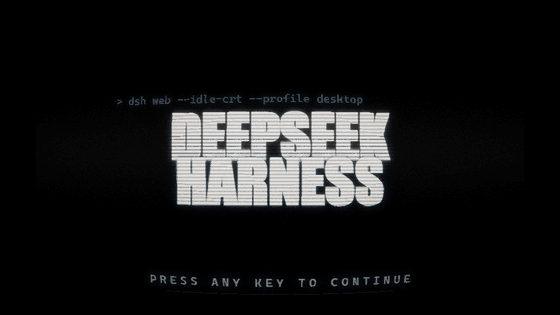
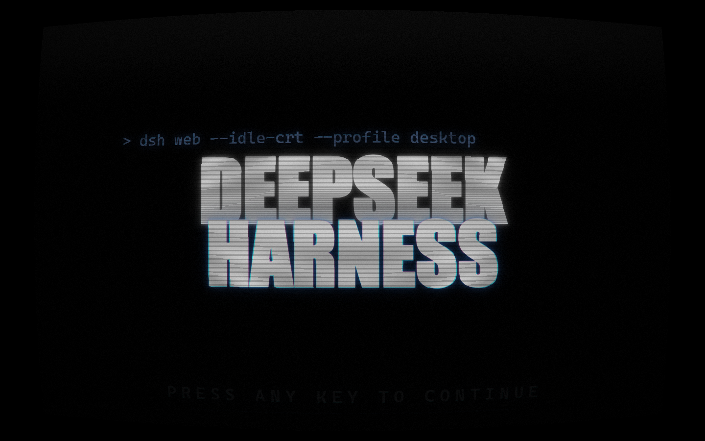
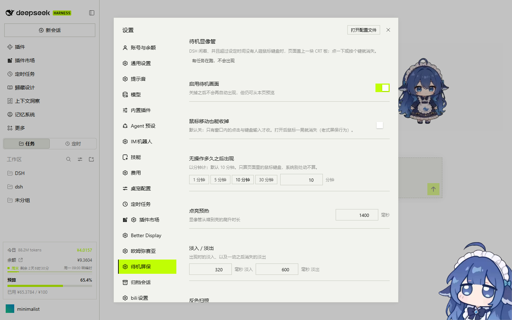

<div align="center">


# 🖥️ dsh-idle-crt

**十分钟没动静，给终端亮一块显像管。**

DSH 闲着、并且超过设定时间没人碰鼠标键盘时，页面盖上一块 CRT 板——辉光字、扫描线、循环反色扫掠；在窗口里点一下或按个键就消失。

<p>
  <a href="https://www.npmjs.com/package/dsh-idle-crt"></a>
  <a href="https://www.npmjs.com/package/dsh-idle-crt"></a>
  <a href="https://github.com/yuanzephyr920-oss/dsh-idle-crt/stargazers"></a>
  <a href="LICENSE"></a>
  
  
  
</p>

<p>
  <a href="#一眼">看一眼</a> ·
  <a href="#快速开始">快速开始</a> ·
  <a href="#什么时候出现什么时候消失">出现与消失</a> ·
  <a href="#和别的插件共存">共存</a> ·
  <a href="#配置">配置</a> ·
  <a href="#工作原理">工作原理</a> ·
  <a href="#性能">性能</a> ·
  <a href="#数据与信任">数据与信任</a> ·
  <a href="#来源与致谢">来源与致谢</a>
</p>

<p><sub>简体中文 · <a href="docs/README.en.md">English summary</a></sub></p>

</div>

---

> **来源声明**：本项目是 [justawebsite/dsh-splash-crt](https://github.com/justawebsite/dsh-splash-crt) 的**衍生改造（adaptation）**。
> 上游把它做成「启动一闪而过的 CRT 闪屏」，本插件把它改成「待机时才出现的屏保」，
> 并补上了空闲检测、输入语义、与其它插件的共存层、设置页与 GPU 合成。
> 画面部分（CRT 着色器、反色扫掠、辉光字排版）源自上游，MIT 协议，版权归其作者。
> 详细改动与致谢见 [来源与致谢](#来源与致谢)。

## 一眼



一轮完整循环 38 秒（预热 → 白色反色扫掠 → 停留 → 黑色反向扫掠 → 停留），这里 12.5 fps、560×315 抽样；真实画布是 60 fps 的全屏 GPU 合成。

| 预热瞬间 | 设置 → 待机屏保 |
|---|---|
|  |  |

## 快速开始

要求：DSH **0.2 及以上**，浏览器端支持 WebGL（这机器上基本都满足）。

```powershell
# 1) 从 npm 装（推荐）
dsh plugin --profile desktop add dsh-idle-crt

# 2) 或者直接链一个本地目录（改代码时更方便）
dsh plugin --profile desktop add link:G:/DSH/dsh-idle-crt
```

装完**重启一次 DeepSeek Harness**（客户端模块清单在启动时扫描），之后：

- 想让画面现在出现：**设置 → 待机屏保 → 立刻看一眼**；
- 想马上生效地调参数：设置页改完点「保存」，画面参数当场热更新；
- 只想临时看效果、不装插件：`node tools/preview-server.mjs 8791`，打开 `http://127.0.0.1:8791/tools/preview.html`。

## 什么时候出现，什么时候消失

**出现**（两个条件同时满足）

1. DSH 没有正在跑的活（`busy=false`）；
2. 距离上一次**页面内**输入超过阈值（默认 **10 分钟**），且标签页是可见的。

**消失**

- **在窗口里点一下**、**按一个键**、触摸一下、右键一下 —— 立刻淡出；
- 鼠标只是**移动**不算（默认如此）。这是刻意的：「动一下鼠标就收起」的老式屏保，在被远程桌面、被猫碰到的桌子上是灾难；配置里可改回老行为（`dismissOnMove`）；
- 滚轮只锁住页面滚动，不收起画面——滚动一下往往只是「人在看」。

**不会出现的情况**：页面里有全屏元素、有打开的模态框（`aria-modal`）、有**面积 ≥ 视口 20% 的正在播放的视频**；标签页在后台。别的插件也可以主动按住它（见下节）。

## 和别的插件共存

这类「全屏覆盖层」最容易跟主题、宠物、HUD 打架，所以这里是显式处理的：

- **叠得上去**：挂载时量一遍 `body` 下所有大面积浮层的最大 `z-index`，取 `max+10`；之后 `MutationObserver` 盯新挂的层 + 每 500 ms 复查，别人的 HUD 后挂也会被追上（单调不回退）。收板后页面原状。
- **自动让路**：全屏、`aria-modal` 对话框、**占视口 ≥20% 的播放中视频**。小尺寸的装饰视频（例如宠物挂件那种 440×248 的循环动画）**不算**——否则屏保永远不出现。
- **合作信号**：板子盖着时 `<html data-dsh-idle-crt="active">`，别的动画插件可以据此暂停自己的动画；收板即清除。
- **请它让一让**：`window.__DSH_IDLE_CRT__.hold('reason')` / `.release('reason')`（成对使用），整页禁用用 `window.__DSH_IDLE_CRT_SUPPRESS__ = true`。
- **调试接口**：`__DSH_IDLE_CRT__.snapshot()`、`.show()`、`.hide()`、`.setBusy(v)`、`.setIdleMs(ms)`、`.activity()`。

## 配置

设置页是「设置 → 待机屏保」；也可以直接写 `$DSH_HOME/idle-crt.settings.json`，或者改插件行配置（`cordis.patch.yml`）。
优先级：**设置页写下的文件 > 插件行配置 > 内置默认**。

| 键 | 类型 | 默认 | 说明 |
|---|---|---|---|
| `enabled` | bool | `true` | 总开关 |
| `idleMs` | number | `600000` | 多久没输入才出现（ms），设置页按分钟填 |
| `pollMs` | number | `1500` | 向宿主查询 busy 的间隔（ms） |
| `fadeInMs` | number | `320` | 出现时的淡入 |
| `fadeOutMs` | number | `600` | 消失时的淡出 |
| `bootMs` | number | `1400` | 显像管「点亮预热」时长 |
| `wipeStartMs` | number | `4000` | 画面出现后多久开始第一次反色扫掠 |
| `wipeMs` | number | `14000` | 一程扫掠多久（白、黑各一程，交替循环） |
| `wipeHoldMs` | number | `5000` | 每程扫完停留多久 |
| `scanlineIntensity` | number | `1` | 扫描线强度 0–2 |
| `promptText` | string | `PRESS ANY KEY TO CONTINUE` | 底部提示语（留空用默认，最长 80 字符） |
| `dismissOnMove` | bool | `false` | 鼠标移动也收起（老式屏保行为） |

## 工作原理

两个半边：

- **宿主半边**（`lib/index.js`）：订阅 `agent/status` 与 `api-session/status` 维护「哪些会话在跑」，并在每次 `state.json` 请求时用 `agents.list()` 重算一遍兜底；对外只暴露 `/dsh-idle-crt/{state,settings}.json` 与画面脚本。
- **浏览器半边**（`lib/plate.js`，自举脚本 + 一个独立客户端模块 `lib/client.js` 提供设置页）：控制器盯着输入与 `state.json`，够条件才挂载画面。

画面本身是一条 GPU 管线：

1. 文字（DEEPSEEK / HARNESS / TUI 行 / 底部提示 / 辉光 / 扫描线洞）在**挂载时**画进两张离屏图层，上传成两张纹理——只在窗口尺寸或提示语变化时重做；
2. 每帧只设几个 uniform、一次 `drawArrays`：预热斜坡、灯管闪烁、亚像素摆动、提示语渐显与呼吸、扫描线、滚动亮带、颗粒、暗角、RGB 色散、反色扫掠与青色边界、淡出，**全部在片元着色器里**；
3. 没有任何逐帧的 2D 绘制或纹理上传。

## 性能

1440×900、6 秒稳态采样（rAF 间隔）：

| 版本 / 路径 | 平均 | p50 | p99 |
|---|---|---|---|
| 0.1.4 每帧重画 2D（SwiftShader） | 90.3 ms | 83.4 | 150 |
| 0.1.5 层缓存 + 隔帧上传（SwiftShader） | 41.4 ms | 49.9 | 83.3 |
| **0.2.0 全 GPU 合成（SwiftShader，软渲染上限）** | **32.5 ms** | 33.3 | 50 |
| **0.2.0 全 GPU 合成（RTX 4060 / ANGLE D3D11）** | **16.6 ms** | 16.7 | 16.8 |

真机上 p99 与 p50 相同——满帧 60 fps。复测：`node tools/diag-perf-gpu.mjs 8791 gpu`（会打印实际 renderer 名字）。

## 开发

```powershell
npm install                      # 只装 esbuild（其余零依赖）
node tools/build.mjs             # src/client/index.js -> lib/plate.js
node tools/preview-server.mjs 8791
# 打开 http://127.0.0.1:8791/tools/preview.html   （可加 ?bare=1 / ?freeze=screen1:6 / ?idle=2）
```

目录：

```
lib/index.js        宿主半边：busy 跟踪、设置读写、路由
lib/bootstrap.js    注入到页面 <body> 的自举脚本（只负责拉起画面脚本）
lib/plate.js        画面脚本（esbuild 打包产物，改 src 后重新 build）
lib/client.js       设置页（dsh.client 客户端模块，注册到 settings.section）
src/client/index.js 画面源码
tools/              构建、预览、验收、性能探针
```

验收脚本（都要带 base URL，桌面端每次重启端口会变）：

| 脚本 | 验什么 |
|---|---|
| `verify-preview.mjs <base>` | 预览页：像素、反色、移动不收、点击收、busy 压制 |
| `verify-gui.mjs <base>` | 真 GUI：出现、z 轴、marker、移动不收、点击收、页面仍可用 |
| `verify-cycle.mjs <base>` | 一轮循环：键盘关→再现→移动/滚轮不关→点击关→hold/release |
| `verify-compat.mjs <base>` | 共存：更高 HUD、模态框、大视频让路、小宠物视频不挡、SUPPRESS |
| `verify-settings-gui.mjs <base>` | 设置页：字段、保存落盘、立刻看一眼 |
| `diag-perf-gpu.mjs <port> gpu\|sw` | 帧率与真实 renderer 名 |

宿主路由（除调试路由外都在 `/dsh-idle-crt/` 下）：`state.json`、`settings.json`（GET/POST）、`client.js`、`bootstrap.js`；
调试用的 `auth-url.json` / `debug.json` / `diag` 仅回环可访问。

## 数据与信任

- **不联网**：插件没有任何外发请求，画面与设置都在本机。
- **只写一个文件**：`$DSH_HOME/idle-crt.settings.json`（默认 `C:\Users\<你>\.dsh\idle-crt.settings.json`）。删掉它就回到内置默认。
- **调试路由只在回环**：`auth-url.json`（给无头测试换登录 Cookie）与 `debug.json`/`diag` 只在 `127.0.0.1` / `::1` 可用，非回环一律 403。
- 不动 DSH 本体、不注册全局快捷键、不改别的插件的 DOM。

## 来源与致谢

**上游（本项目的来源）**

- [**justawebsite/dsh-splash-crt**](https://github.com/justawebsite/dsh-splash-crt) —— MIT，CRT 画面、反色扫掠算法、辉光字排版均来自这里，作者 **justawebsite** 及其贡献者。
  上游做的是「DSH 启动时一闪而过的闪屏」；本插件把它改成「闲置十分钟后才出现的待机屏保」，
  保留上游的画面语言与着色器思路，重写了触发、输入、共存与渲染路径。

**本仓库相对上游的主要改动**

1. 触发：从「启动时无条件显示」改为「宿主 busy=false 且页面内闲置超阈值」，并去掉启动时隐藏页面的行为；
2. 输入：默认只有「窗口内点击 / 按键」才收板（上游是任意输入），滚轮改为只锁滚动，新增 `dismissOnMove` 开关；
3. 宿主：新增 busy 检测（`agent/status` + `api-session/status` + `agents.list()` 兜底）、设置持久化与 `state.json`/`settings.json`；
4. 新增一整页设置界面（`settings.section` 槽位），改完参数当场生效并落盘；
5. 共存层：z-index 动态爬升、全屏/模态/视频让路（含 20% 视口门槛）、`hold/release`、`data-dsh-idle-crt="active"` 合作信号；
6. 渲染：从「每帧重画 2D + 上传纹理」改为「图层一次上传 + 片元着色器逐帧合成」，真机 60 fps；
7. 工程：esbuild 构建、预览页、五套 Playwright 验收脚本与性能探针。

**致谢**

- **justawebsite** 与 dsh-splash-crt 的贡献者：没有那块板就没有这个插件。
- **DeepSeek Harness** 与 Cordis 插件系统：`webserver/index-inject`、`settings.section`、`dsh.client` 这些入口让「不改本体」成为可能。
- 本机实测中与它同场竞技、也顺手暴露了不少坑的插件：**dsh-theme-mls-desktop**（主题壳与设置面板）、**dsh-pet**（小尺寸自动播放视频一度让它永不出现）、**billion-context / 上下文洞察**（大面积深色画布与浮层）、**dsh-better-display**（高 z-index HUD）。共存逻辑基本都是被它们逼出来的。
- 上游 README 里那份动画时间轴的说明，本项目的默认参数直接沿用了它的节奏。

## 许可证

[MIT](LICENSE)。上游同为 MIT；本仓库保留上游版权声明，衍生部分版权归 dsh-idle-crt contributors。
